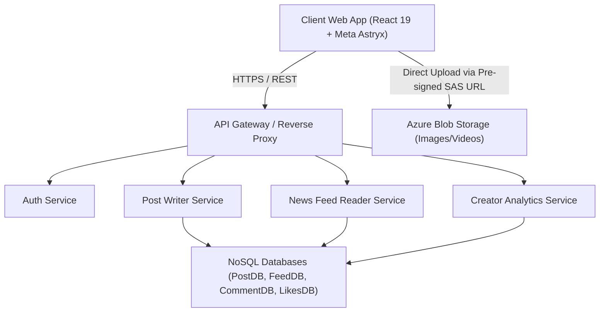

# Social Media Content Analysis System (SMCAS)

[](https://github.com/SyedMuhammadHunain/social-media-content-analytic-system/actions/workflows/ci.yml)
[](https://github.com/facebook/astryx)
[](https://react.dev/)
[](https://www.typescriptlang.org/)
[](LICENSE)

An enterprise-grade, event-driven Social Media Content Analysis and Creator Telemetry System built in accordance with **NED University of Engineering & Technology (Department of Computer Science & Information Technology) Object-Oriented Analysis & Design (OOAD CT-263)** report.

---

## Architecture Overview



---

## Core Implemented Capabilities

### 1. Unified Clean Navigation & Dynamic Theming (PDF Req 4.1.i)
- Official **Meta Astryx** (`@astryxdesign/core`) TopNav with dark/light mode toggle.
- Single-click switching between **News Feed** and **Creator Analytics Dashboard**.

### 2. User Authentication Split-Card (PDF Req 4.1.i)
- Responsive split-card modal with form validation, error banners, and password visibility toggles.
- Session persistence in local state and sign-out capabilities.

### 3. Chronological News Feed & Unified Post Composer (PDF Req 4.1.ii, vi)
- Single unified post composer supporting text, local photo, and video attachments without tab fragmentation.
- Reverse chronological feed stream with full like/unlike toggles and interactive comment drawer.

### 4. Post Lifecycle Management — Create, Edit, Delete (PDF Req 4.1.ii)
- **Author Gate:** Edit and Delete buttons render only on posts authored by the active creator.
- **PostEditModal:** In-place editing of text, media URLs, and hashtag categories.
- **Delete Confirmation:** Guarded destructive overlay preventing accidental post removal.

### 5. Creator Profile & Bio Editor (PDF Req 4.1.iv, v)
- Fixed left sidebar card and full profile view with overlapping avatar banner design.
- Interactive inline bio editor with real-time character count and banner feedback.

### 6. Dedicated Creator Analytical Dashboard (PDF Req 4.1.vii, viii, ix & 4.2)
- **Like / Unlike Bar Chart:** Performance breakdown across past 7 days.
- **Followers Trend Line Chart:** Net follower gain/loss telemetry.
- **Engagement Multi-Metric Chart:** Views, comments, and engagement score.
- **Sub-2-Second Real-Time Sync:** Feed interactions (likes, follows, comments) update analytics charts within 2 seconds.

---

## Repository Directory Structure

```
social-media-content-analysis-system/
├── .github/
│   └── workflows/
│       └── ci.yml               # Automated GitHub Actions CI pipeline
├── docs/
│   ├── requirements/            # Original NED University OOAD CT-263 requirements
│   ├── specs/                   # 9 Formal feature specifications (SPEC-*.md)
│   ├── reports/                 # 11 Verification & Code Review reports
│   │   └── screenshots/         # 37 Automated high-res test evidence screenshots
│   └── intent/                  # Intent extraction documents
├── frontend/
│   ├── src/
│   │   ├── app/                 # Feed, Composer, PostCard, PostEditModal, TopNav
│   │   ├── components/          # ProfileCard, ProfileView, Analytics Dashboard, Auth
│   │   ├── mock/                # Seed data & in-memory real-time telemetry stores
│   │   └── types/               # Strict TypeScript interface contracts
│   └── test/                    # 6 Automated CDP browser integration test suites (36 tests)
└── tasks/
    ├── plan.md                  # Active implementation architecture plan
    └── todo.md                  # Execution task checklist
```

---

## Getting Started

### Prerequisites
- **Node.js:** v20+ (recommended v22+)
- **Google Chrome:** (for running headless CDP test suites)
- **Package Manager:** `npm`

### Installation & Local Run
```bash
# Clone the repository
git clone https://github.com/SyedMuhammadHunain/social-media-content-analytic-system.git
cd social-media-content-analysis-system/frontend

# Install dependencies
npm install

# Start development server
npm run dev
```
Open [http://localhost:5173](http://localhost:5173) in your browser.

---

## Automated Verification Suite

All 6 test suites execute against live browser DOM via Chrome DevTools Protocol (CDP):

```bash
cd frontend

# Run linting (Oxlint)
npm run lint

# Run TypeScript compilation check
npx tsc -b

# Run full automated test suite (36 tests across 6 suites)
npm test

# Build production bundle
npm run build
```

---

## Documentation Index
- [Specifications](docs/specs/)
- [Verification & Quality Reports](docs/reports/)
- [Course Requirements](docs/requirements/Requirements)
