<div align="center">

# 📊 Social Media Content Analysis System (SMCAS)

**Enterprise-Grade, Event-Driven Creator Analytics & Telemetry Platform**

*Developed for the Department of Computer Science & Information Technology, NED University of Engineering & Technology (OOAD CT-263)*

---

[](https://github.com/SyedMuhammadHunain/social-media-content-analytic-system/actions/workflows/ci.yml)
[](https://github.com/facebook/astryx)
[](https://react.dev/)
[](https://www.typescriptlang.org/)
[](https://vite.dev/)
[](https://www.oracle.com/java/)
[](https://spring.io/projects/spring-boot)
[](https://www.mongodb.com/)
[](https://azure.microsoft.com/)
[](https://chromedevtools.github.io/devtools-protocol/)
[](LICENSE)
[](docs/academic/)

</div>

---

## 📑 Table of Contents
- [Executive Overview](#-executive-overview)
- [System Architecture](#-system-architecture)
  - [High-Level Architecture Map](#high-level-architecture-map)
  - [Microservice Sequence Workflows](#microservice-sequence-workflows)
- [Key Features & User Interface](#-key-features--user-interface)
  - [Chronological News Feed & Timeline](#1-chronological-news-feed--timeline)
  - [Creator Analytics Dashboard](#2-creator-analytics-dashboard)
  - [Engagement Proportionality & Discussion Vitality](#3-engagement-proportionality--discussion-vitality)
  - [Creator Profile & Bio Management](#4-creator-profile--bio-management)
  - [Unified Post Composer & Rich Media Attachments](#5-unified-post-composer--rich-media-attachments)
  - [Live Comments Drawer & Rapid Search](#6-live-comments-drawer--rapid-search)
  - [Notification Center](#7-notification-center)
  - [Authentication Portal](#8-authentication-portal)
- [Microservices Architecture Breakdown](#-microservices-architecture-breakdown)
- [Technology Stack](#-technology-stack)
- [Repository Directory Layout](#-repository-directory-layout)
- [Getting Started & Local Setup](#-getting-started--local-setup)
  - [Prerequisites](#prerequisites)
  - [Frontend Setup](#frontend-setup)
  - [Backend Microservices Setup](#backend-microservices-setup)
- [Automated Verification & Quality Gates](#-automated-verification--quality-gates)
- [Academic Context & Project Team](#-academic-context--project-team)
- [License](#-license)

---

## 🔭 Executive Overview

The **Social Media Content Analysis System (SMCAS)** is an enterprise-scale, event-driven platform engineered to bridge the gap between high-velocity content distribution and sub-second creator feedback loops.

Built to fulfill the academic specifications of **NED University of Engineering & Technology (Department of Computer Science & Information Technology) Object-Oriented Analysis & Design (OOAD CT-263)**, the platform handles massive read/write asymmetric workloads through decoupled microservices, pre-computed fan-out feeds, direct-to-cloud object storage uploading, and real-time analytical telemetry.

### Core Architectural Pillars
- **Strict Design System Fidelity:** Standardized with Meta's official Astryx design tokens (`@astryxdesign/core`) supporting dynamic high-contrast dark and light modes.
- **Asymmetric Read/Write Optimization:** Decouples post submission from fan-out delivery using dedicated reader and generator services.
- **Direct-to-Cloud Ingestion:** Employs pre-signed SAS URLs for Azure Blob Storage, insulating backend services from raw video/image payload streaming.
- **Real-Time Analytical Feedback:** Sub-2-second telemetry synchronization reflecting engagement scores, follower velocity, and sentiment indices.

---

## 🏛️ System Architecture

### High-Level Architecture Map

The end-to-end distributed system connects client experiences, API gateways, event processors, and persistence tiers:

<div align="center">
  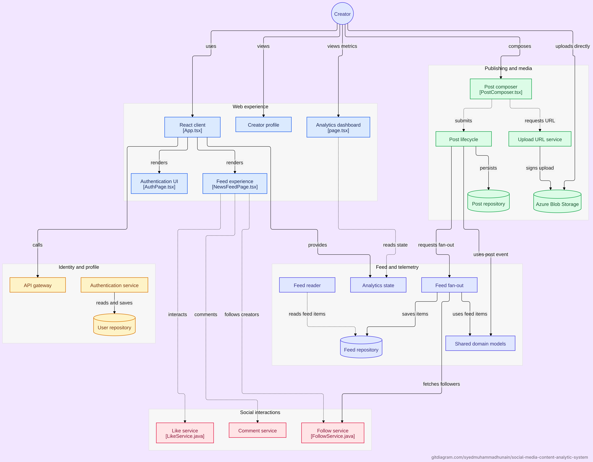
</div>

```mermaid
flowchart TD
    Client["Client Web App\n(React 19 + Meta Astryx)"]
    Gateway["Spring Cloud Gateway\n(Port 8080)"]
    AuthSvc["Authentication Service\n(Google OAuth2 / JWT)"]
    PostWriter["Post Writer Service"]
    FeedReader["Newsfeed Reader Service"]
    FeedGen["Newsfeed Generator Service"]
    SocialSvc["Social Interactions\n(Like, Follow, Comment)"]
    AzureBlob["Azure Blob Storage\n(Images / Videos)"]
    PresignedSvc["Pre-Signed URL Service"]
    MongoAtlas[("MongoDB Atlas NoSQL Clusters\n(PostDB, FeedDB, CommentDB, FollowDB)")]

    Client -->|REST / HTTPS| Gateway
    Client -->|Direct Binary Upload (SAS)| AzureBlob
    Gateway --> AuthSvc
    Gateway --> PresignedSvc
    Gateway --> PostWriter
    Gateway --> FeedReader
    Gateway --> SocialSvc

    PostWriter -->|Persist Post| MongoAtlas
    PostWriter -->|Trigger Fan-out| FeedGen
    FeedGen -->|Query Graph & Update| MongoAtlas
    FeedReader -->|Read Precomputed Stream| MongoAtlas
    SocialSvc -->|Real-Time Counters| MongoAtlas
```

---

### Microservice Sequence Workflows

Detailed sequence interactions derived from the system's formal OOAD specification:

#### 1. Post Creation & Media Upload Pipeline
Clients request secure pre-signed upload URLs, transfer assets directly to Azure Blob Storage, and publish metadata through the Post Writer service with automatic feed fan-out triggers:

<div align="center">
  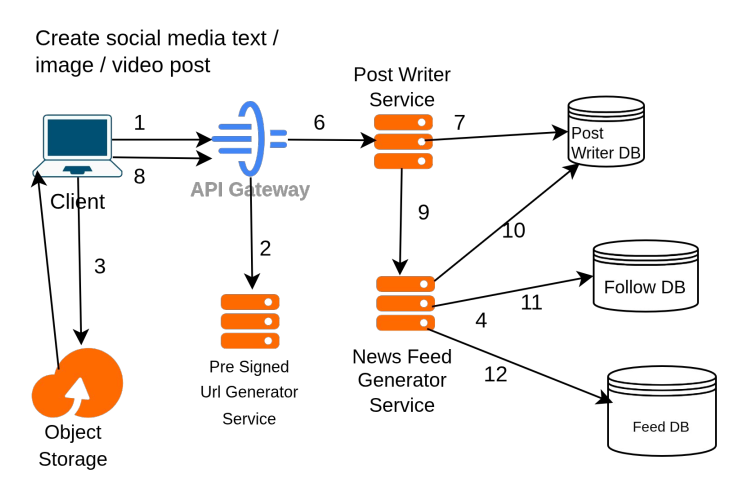
</div>

#### 2. News Feed Retrieval & Fan-out Engine
High-throughput chronological feed delivery backed by pre-computed fan-out queues and optimized indexing:

<div align="center">
  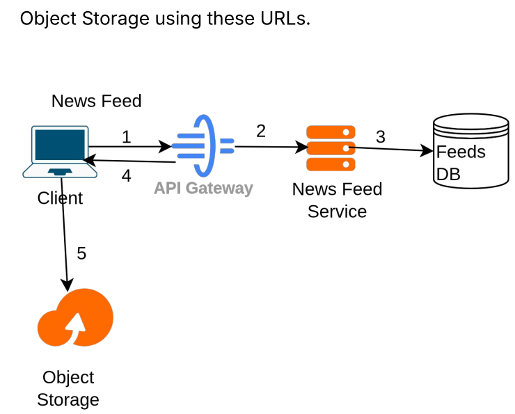
</div>

#### 3. Social Interaction Microservices (Like, Follow, Comment)
Low-latency stateful events propagating instant updates to content owners and analytics pipelines:

| Like / Unlike Workflow | Follow / Unfollow Graph | Comment & Discussion Vitality |
| :---: | :---: | :---: |
| 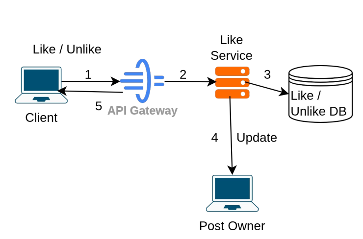 | 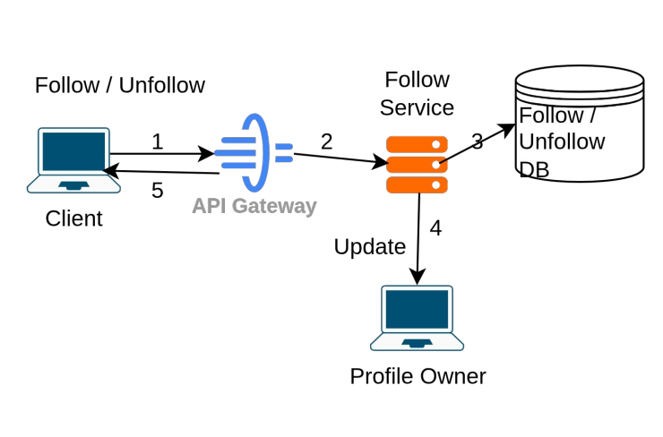 | 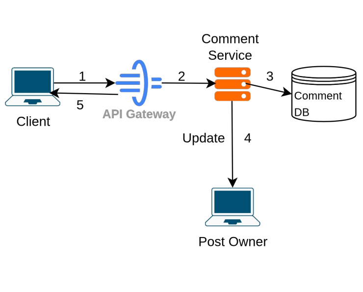 |

---

## 🎨 Key Features & User Interface

### 1. Chronological News Feed & Timeline
Features chronological post streaming, creator verification badges, inline media rendering, one-click bookmarks, and responsive sidebar navigation styled in Meta Astryx dark theme.

<div align="center">
  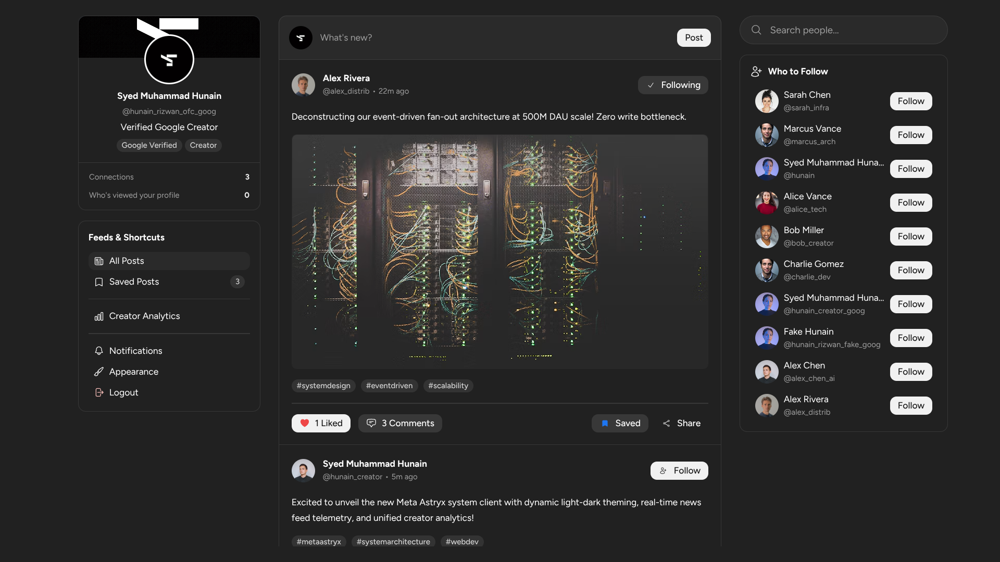
</div>

---

### 2. Creator Analytics Dashboard
Real-time KPI telemetry tiles tracking Total Followers, Total Likes, Engagement Rate, and Total Comments alongside 7-day Sentiment Breakdown (Likes vs. Unlikes) and Follower Growth Velocity.

<div align="center">
  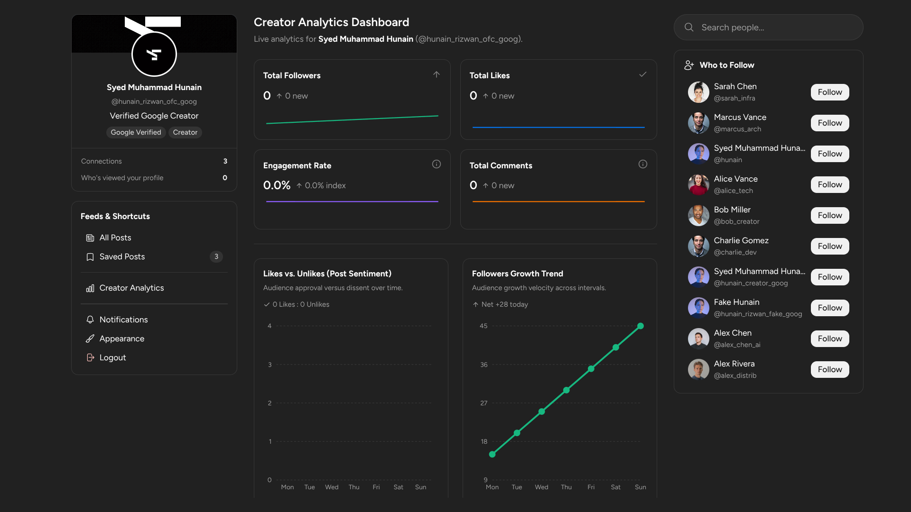
</div>

---

### 3. Engagement Proportionality & Discussion Vitality
Deep metric telemetry including Creator Engagement & Comments Proportionality Index curves, Audience Velocity tracking, and Discussion Vitality scores.

<div align="center">
  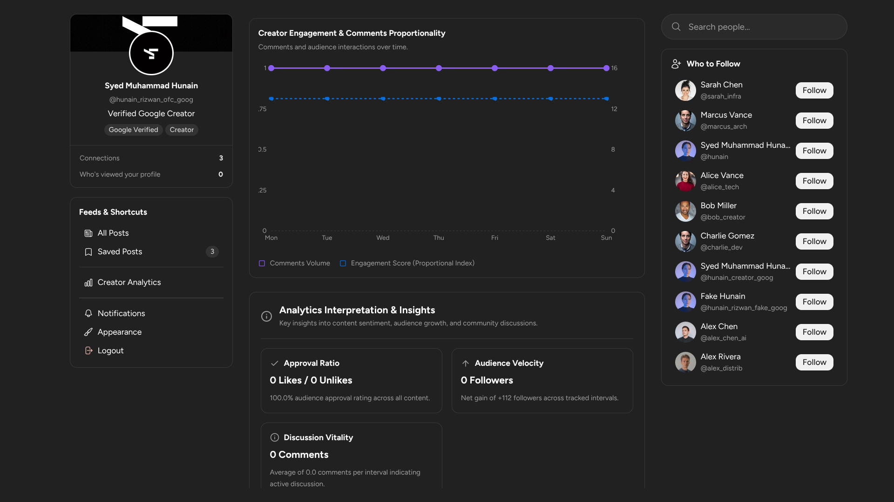
</div>

---

### 4. Creator Profile & Bio Management
Personalized creator profile header with overlapping avatar badges, customizable banner images, inline bio editor with character counter, follower counts, and dedicated post history tabs.

<div align="center">
  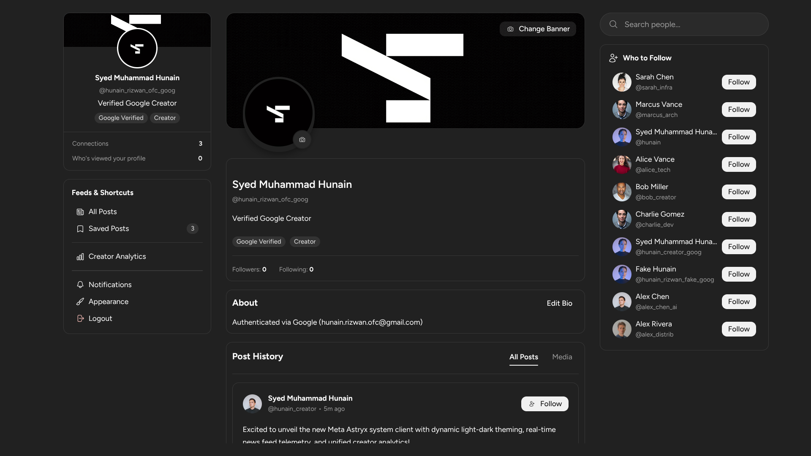
</div>

---

### 5. Unified Post Composer & Rich Media Attachments
Seamless post composer modal supporting rich text formatting, direct image/video file attachments, and integrated Tenor GIF selection without tab fragmentation.

<div align="center">
  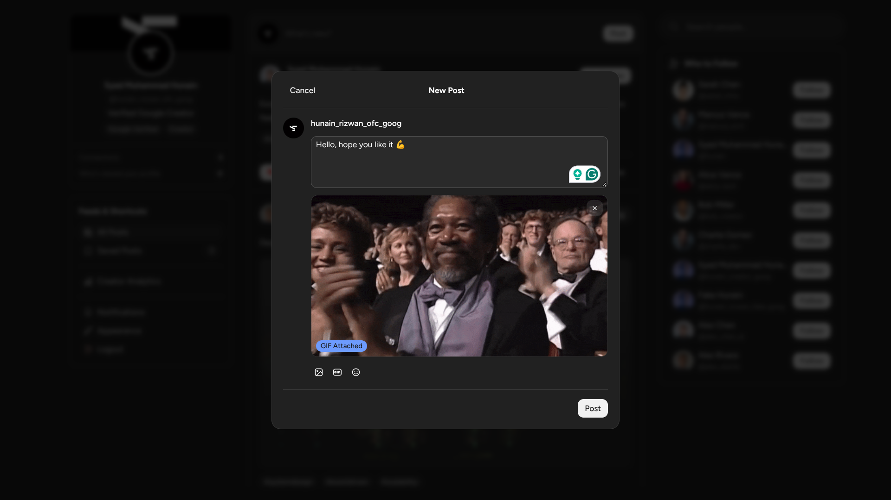
</div>

---

### 6. Live Comments Drawer & Rapid Search
Interactive comment drawer with nested responses, GIF and image comment support, and top navigation instant user lookup search modal.

<div align="center">
  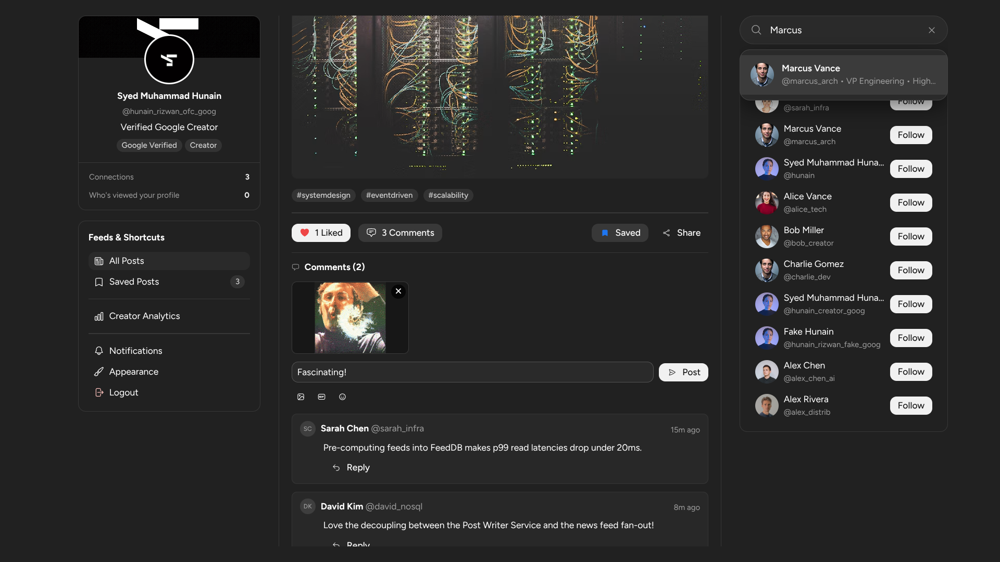
</div>

---

### 7. Notification Center & Authentication Portal
Real-time activity feed alerting creators about likes, comments, and new followers, coupled with split-card login/signup interfaces featuring Google OAuth integration.

| Activity & Notifications Center | Authentication (Login & Registration) |
| :---: | :---: |
| 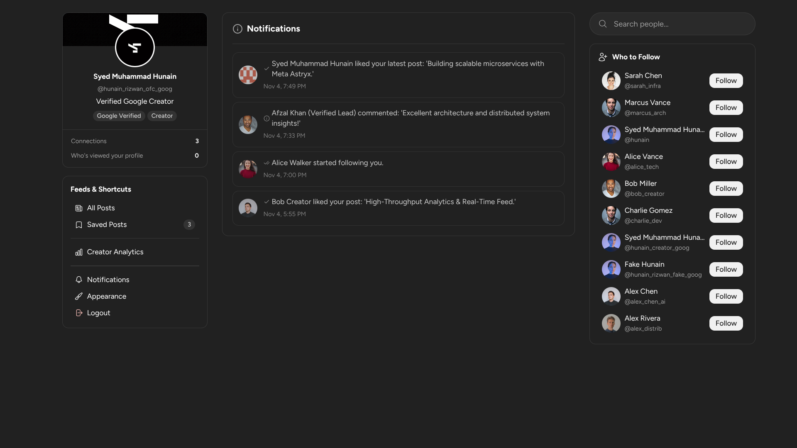 | 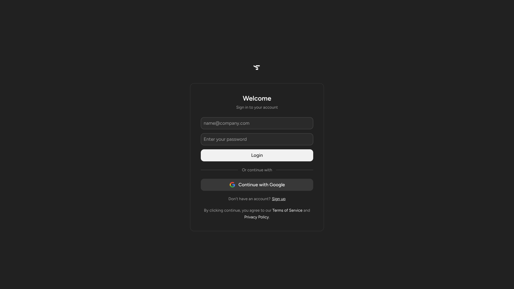 |

---

## ⚙️ Microservices Architecture Breakdown

The backend is built as a modular Maven multi-module ecosystem running on **Java 21** and **Spring Boot 3.4.2**:

| Module | Port | Primary Responsibility | Backing Storage |
| :--- | :---: | :--- | :--- |
| **`api-gateway`** | `8080` | Dynamic route proxying, CORS policy resolution, client rate limiting, JWT validation | Memory / Redis |
| **`presigned-url-service`** | `8081` | Generates short-lived SAS upload/read tokens for Azure Blob Storage | Azure Blob SDK |
| **`post-writer-service`** | `8082` | Handles post CRUD operations, author gating, and emits feed generation events | MongoDB (`posts`) |
| **`newsfeed-generator-service`** | `8083` | Asynchronous fan-out engine distributing post IDs into follower feed collections | MongoDB (`feeds`) |
| **`newsfeed-reader-service`** | `8084` | Hydrates and serves chronological feed pages with sub-20ms p99 latency | MongoDB (`feeds`) |
| **`like-unlike-service`** | `8085` | High-concurrency atomic counter updates for post likes and unlikes | MongoDB (`likes`) |
| **`comment-service`** | `8086` | Manages threaded discussions, media attachments, and comment notifications | MongoDB (`comments`) |
| **`follow-service`** | `8087` | Maintains directional creator social graph (followers and following) | MongoDB (`follows`) |
| **`common-models`** | N/A | Shared domain records, DTO envelopes (`ApiResponse<T>`), and utility contracts | Shared Library |

---

## 💻 Technology Stack

### Frontend Client
- **Core Framework:** React 19 (`react`, `react-dom`)
- **Type System:** TypeScript 5.8 with strict null checks
- **Design System:** Meta Astryx (`@astryxdesign/core`)
- **Build & Development:** Vite 8, ESBuild
- **Icons:** Lucide React (`lucide-react`)
- **Linting & Code Analysis:** Oxlint

### Backend Microservices
- **Language & Runtime:** Java 21 LTS
- **Application Framework:** Spring Boot 3.4.2 & Spring Cloud 2024.0.0
- **Cloud Gateway:** Spring Cloud Gateway (Reactive WebFlux)
- **Object Storage:** Azure Storage Blob Java SDK 12.28.0
- **Persistence:** Spring Data MongoDB (Atlas Cluster)
- **Boilerplate Reduction:** Project Lombok 1.18.36
- **Build System:** Apache Maven 3.9+

### Testing & Quality Assurance
- **End-to-End Automation:** Node.js native test runner (`node:test`, `node:assert`)
- **Browser Automation:** Headless Chrome DevTools Protocol (CDP)
- **Verification Coverage:** 36 automated test cases across 6 end-to-end integration suites

---

## 📂 Repository Directory Layout

```
social-media-content-analytic-system/
├── .github/
│   └── workflows/
│       └── ci.yml                     # Continuous integration build & lint pipeline
├── backend/                           # Java 21 / Spring Boot Maven Multi-Module
│   ├── pom.xml                        # Root POM orchestrating all 9 microservice modules
│   ├── api-gateway/                   # Spring Cloud API Gateway (Port 8080)
│   ├── common-models/                 # Shared domain models, DTOs, and envelopes
│   ├── presigned-url-service/         # Azure Blob Storage SAS generator
│   ├── post-writer-service/           # Post ingestion and author lifecycle management
│   ├── newsfeed-generator-service/    # Asynchronous feed fan-out worker
│   ├── newsfeed-reader-service/       # High-speed feed hydration service
│   ├── like-unlike-service/           # Real-time like counter microservice
│   ├── comment-service/               # Threaded comments microservice
│   └── follow-service/                # Social graph follow/unfollow microservice
├── docs/
│   ├── assets/                        # High-resolution README assets
│   │   ├── academic/                  # OOAD report cover and academic proofs
│   │   ├── architecture/              # High-level architecture & flow diagrams
│   │   └── screenshots/               # Verified UI screenshots
│   ├── academic/                      # Course syllabus & project specification
│   ├── reports/                       # Quality, audit, and DevTools verification reports
│   └── specs/                         # Formal feature specifications (SPEC-*.md)
├── frontend/                          # React 19 + TypeScript + Meta Astryx client
│   ├── src/
│   │   ├── app/                       # Feed, Composer, PostCard, TopNav
│   │   ├── components/                # Profile, Analytics Dashboard, Auth Modals
│   │   ├── mock/                      # Seed data & in-memory fallback telemetry
│   │   ├── services/                  # Gateway API clients (auth, feed, posts, social)
│   │   └── types/                     # TypeScript contracts and models
│   ├── test/                          # 6 CDP browser automation test suites
│   └── package.json
└── tasks/
    ├── plan.md                        # Architectural roadmap and implementation plan
    └── todo.md                        # Completed and ongoing task checklist
```

---

## 🚀 Getting Started & Local Setup

### Prerequisites
- **Node.js:** `v20.x` or `v22.x+` (npm included)
- **Java Development Kit (JDK):** Version 21 (Eclipse Temurin / OpenJDK)
- **Apache Maven:** `v3.9+`
- **Google Chrome:** (Required for running headless CDP test suites)

---

### Frontend Setup

1. **Navigate to the frontend directory:**
   ```bash
   cd frontend
   ```

2. **Install project dependencies:**
   ```bash
   npm install
   ```

3. **Launch the development server:**
   ```bash
   npm run dev
   ```
   Open your browser and navigate to `http://localhost:5173`.

4. **Verify TypeScript compilation & linting:**
   ```bash
   npm run lint
   npx tsc -b
   ```

---

### Backend Microservices Setup

1. **Navigate to the backend directory:**
   ```bash
   cd backend
   ```

2. **Configure Environment Variables:**
   Copy the example environment file and set your MongoDB Atlas and Azure Blob credentials:
   ```bash
   cp .env.example .env
   ```

3. **Build the parent POM and compile all microservices:**
   ```bash
   mvn clean package -DskipTests
   ```

4. **Run the API Gateway:**
   ```bash
   mvn spring-boot:run -pl api-gateway
   ```

---

## 🧪 Automated Verification & Quality Gates

The system enforces strict quality gates across both frontend and backend modules:

```bash
# Execute full browser integration suite via Chrome DevTools Protocol
cd frontend
npm test
```

### Automated Suite Matrix

| Test Suite | Scope & Verifications | Status |
| :--- | :--- | :---: |
| `auth_integration_switcher.test.mjs` | Multi-user login, Atlas demo seed persistence, logout | `PASS` |
| `feed_refresh_and_skeleton.test.mjs` | Astryx theme toggle, brand bounce, skeleton loaders | `PASS` |
| `post_edit_delete_author_gate.test.mjs`| Author edit/delete permissions, confirmation overlays | `PASS` |
| `bio_editor_profile.test.mjs` | Avatar banner upload, inline bio editor character count | `PASS` |
| `creator_dashboard_sync.test.mjs` | Sub-2s real-time telemetry updates, chart re-renders | `PASS` |
| `devtools-audit.mjs` | Chrome DevTools zero uncaught console error audit | `PASS` |

---

## 🎓 Academic Context & Project Team

This system was designed and developed in partial fulfillment of the requirements for **Object-Oriented Analysis & Design (Course Code: CT-263)** at **NED University of Engineering & Technology (Department of Computer Science & Information Technology)**, Fall 2026 Semester.

<div align="center">
  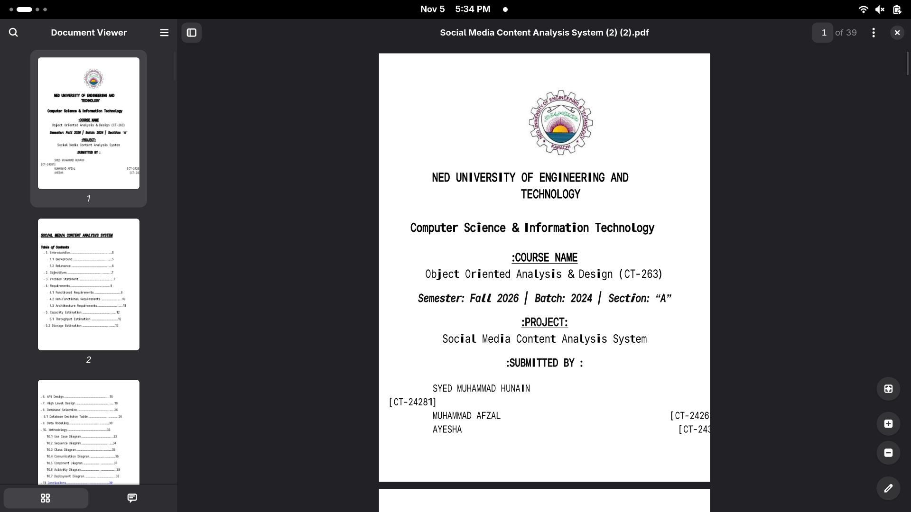
</div>

### Project Authors
- **Syed Muhammad Hunain** — *Roll No: CT-24281*
- **Muhammad Afzal** — *Roll No: CT-24261*
- **Ayesha** — *Roll No: CT-24300*

---

## 📄 License

This project is licensed under the terms of the [MIT License](LICENSE).
