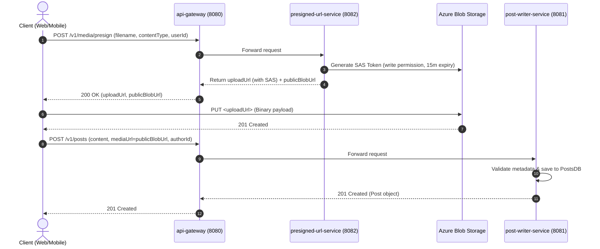

# Backend Microservices System Architecture

## 1. System Topology Overview

The Social Media Content Analysis System backend is built on **Java 21** and **Spring Boot 3.4.2**, partitioned into **8 independent microservices** and **1 shared models library**.

Storage relies on:
- **Microsoft Azure Blob Storage:** Object store for media assets (images, videos) with pre-signed SAS upload URLs.
- **MongoDB Atlas NoSQL:** Distributed document database spanning 5 course collections (`PostsDB`, `LikesDB`, `FollowDB`, `CommentsDB`, `FeedDB`) plus user identity management (`UsersDB`).

```mermaid
flowchart TD
    Client["Frontend Client (React 19 / Astryx)"]
    Gateway["api-gateway (:8080)"]
    
    AzureBlob[("Azure Blob Storage\n(Media Blobs)")]
    MongoAtlas[("MongoDB Atlas\n(NoSQL Collections)")]

    subgraph Ingestion ["Content Ingestion Pipeline"]
        Presign["presigned-url-service (:8082)"]
        PostWriter["post-writer-service (:8081)"]
    end

    subgraph Social ["Social Engagement Services"]
        Like["like-unlike-service (:8083)"]
        Comment["comment-service (:8085)"]
        Follow["follow-service (:8084)"]
    end

    subgraph Feed ["Newsfeed Pipeline"]
        FeedGen["newsfeed-generator-service (:8086)"]
        FeedReader["newsfeed-reader-service (:8087)"]
    end

    Client -->|HTTP / REST| Gateway
    Client -->|Direct Upload via SAS| AzureBlob

    Gateway -->|/v1/media/presign| Presign
    Gateway -->|/v1/posts| PostWriter
    Gateway -->|/v1/like, /v1/unlike| Like
    Gateway -->|/v1/comment| Comment
    Gateway -->|/v1/follow, /v1/unfollow| Follow
    Gateway -->|/v1/feeds/{userId}| FeedReader

    Presign -->|Generate SAS URI| AzureBlob
    PostWriter -->|CRUD| MongoAtlas
    PostWriter -->|Publish Post Event| FeedGen
    FeedGen -->|Query Followers| Follow
    FeedGen -->|Fan-out Write| MongoAtlas
    FeedReader -->|Read Feed| MongoAtlas
    Like -->|Atomic Counter & Ledger| MongoAtlas
    Comment -->|Threaded Comments| MongoAtlas
    Follow -->|Graph Edges| MongoAtlas
```

---

## 2. Microservice Boundaries & Port Map

| Service Name | Port | Primary Responsibility | Data Store |
|---|---|---|---|
| `common-models` | N/A (JAR) | Shared DTOs, document entities, uniform response envelopes | N/A |
| `api-gateway` | `8080` | Reverse proxy, request routing, CORS headers, JWT verification | None (Stateless) |
| `post-writer-service` | `8081` | Text, image, and video post creation, edit, soft delete | `PostsDB` (MongoDB Atlas) |
| `presigned-url-service`| `8082` | Generates short-lived Azure Blob SAS upload tokens | Azure Blob Storage |
| `like-unlike-service` | `8083` | Idempotent like/unlike recording and counter aggregation | `LikesDB`, `PostsDB` (MongoDB Atlas) |
| `follow-service` | `8084` | User follow/unfollow graph and follower lists | `FollowDB` (MongoDB Atlas) |
| `comment-service` | `8085` | Comment threads, post engagement retrieval | `CommentsDB` (MongoDB Atlas) |
| `newsfeed-generator-service` | `8086` | Fan-out engine; writes posts to follower feeds (<2.0s SLA) | `FeedDB` (MongoDB Atlas) |
| `newsfeed-reader-service` | `8087` | Paginated reverse-chronological timeline retrieval | `FeedDB` (MongoDB Atlas) |

---

## 3. Media Ingestion & Azure Blob SAS Workflow

To prevent large binary files from overloading Spring Boot services, uploads bypass application servers and stream directly to Azure Blob Storage via Shared Access Signature (SAS) URLs.



---

## 4. Newsfeed Fan-out Pipeline & Latency SLA

The platform implements a **Fan-out on Write** (Push Model) to satisfy the **sub-2-second sync SLA** for newsfeed availability:

1. User creates a post through `post-writer-service`.
2. `post-writer-service` saves the post to `PostsDB` and invokes `newsfeed-generator-service`.
3. `newsfeed-generator-service` fetches author's follower list from `follow-service`.
4. `newsfeed-generator-service` pushes post references into each follower's feed list in `FeedDB`.
5. Followers querying `newsfeed-reader-service` receive pre-computed, indexed feed results with $O(1)$ query complexity.

---

## 5. Security & Configuration Conventions

- **Zero Hardcoded Credentials:**
  - MongoDB connection string provided strictly via `${MONGODB_URI}`.
  - Azure Storage connection string provided strictly via `${AZURE_STORAGE_CONNECTION_STRING}`.
- **Fail-Safe Fallbacks:**
  - Local development defaults to `mongodb://localhost:27017/social_db` if `${MONGODB_URI}` is unset.
  - Azure client validates connection strings at startup and logs actionable configuration instructions if credentials are missing.
