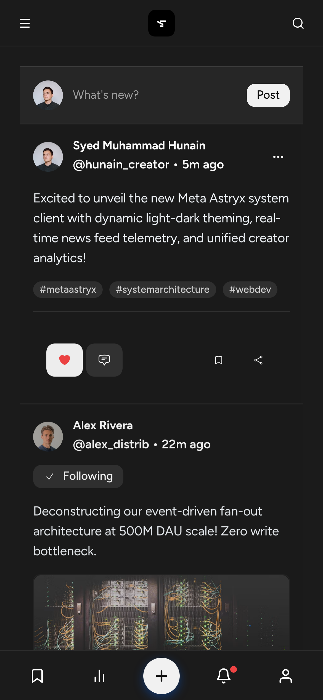
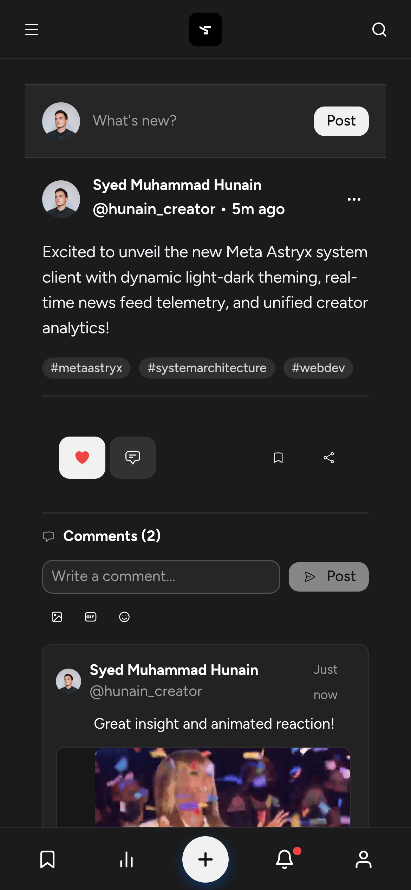
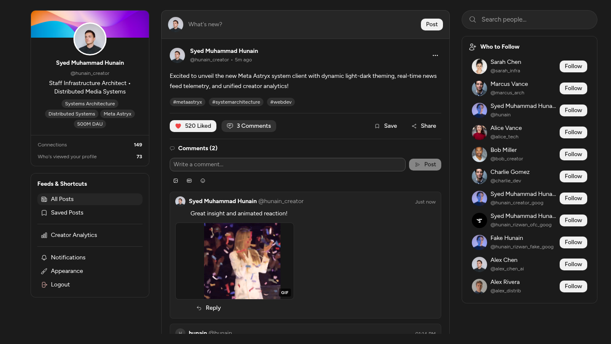

# DevTools Browser Verification Report

Generated: 2026-11-05T08:15:27.435Z

## 1. Android Mobile Viewport Verification (390 x 844)
- **Top Mobile Header:** Hamburger button on left, centered logo with zero "SocialPulse" text title, search on right.
- **Full Width Edge-to-Edge:** Center scroll padding: `0px` / `0px` (0px side margins, covers full device width).
- **Card Padding & Sizing:** Optimized at `16px`.
- **Readability & Typography:** Post text font size: `16px`, line height: `24px`.
- **Icon-Only Post Actions:** All 4 post action buttons rendered strictly as icons without text strings (PASSED).
- **Screenshot:** 

## 2. Comments Section, Deduplication & Media/GIF Toolbar
- **Toolbar Actions:** Media photo button, GIF button, and Emoji button present and functional.
- **GIF Picker Integration:** Successfully opened `GifPickerPopover`, searched, and attached animated GIF.
- **Attachment Preview:** Rendered `comment-media-preview` with remove button.
- **Deduplication Check:** Newly submitted comment was rendered **exactly 1 time(s)** (Zero 3x duplicates!).
- **Attached Media Rendering:** Rendered attached animated GIF with "GIF" badge inside comment thread.
- **Screenshot:** 

## 3. Desktop Viewport Verification (1440 x 900)
- **3-Column Architecture:** Left rail visible, right rail visible, mobile header and bottom nav hidden.
- **Desktop Post Actions:** Display numerical counts and labels (`520 Liked`).
- **Screenshot:** 

## 4. Console Cleanliness
- **Total Console Logs:** 3
- **Fatal Exceptions / Errors:** 0 (PASSED)
