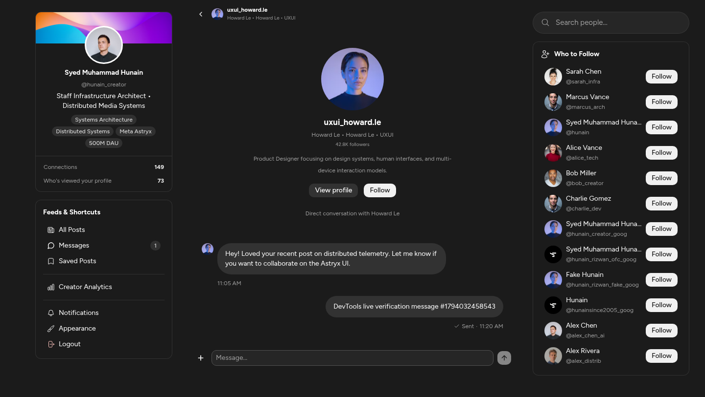
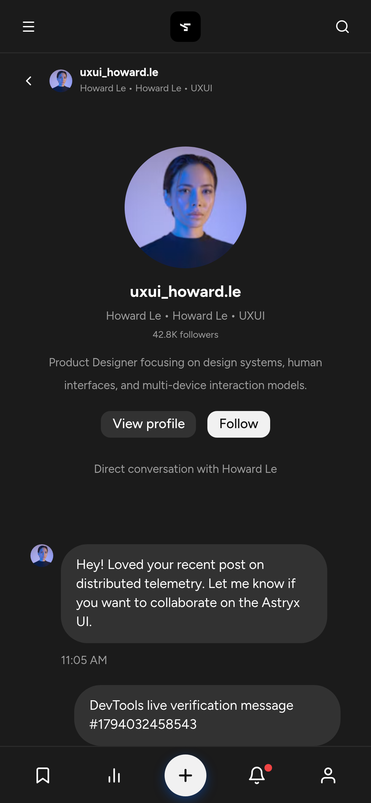
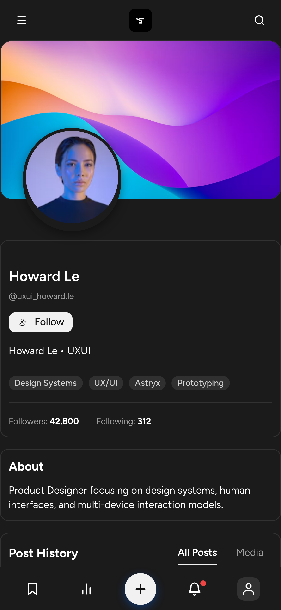

# DevTools Browser Verification Report: Direct Messaging & Chat

**Generated:** 2026-11-07T06:21:01.458Z  
**Environment:** Headless Chromium via Chrome DevTools Protocol (CDP)  
**Target:** `http://127.0.0.1:5173/`  

---

## 1. Desktop Verification (1440 x 900)
- **Thread Rendering:** `ChatThreadView` successfully mounted in center column.
- **Top Identity Bar (Fixed):** Compact identity bar present outside scroll area (PASSED).
- **Profile Presentation (Scrollable):** Large profile presentation correctly rendered inside `chat-messages-scroll-area` (PASSED). As the chat grows, it scrolls upward naturally.
- **Bottom Composer Layout:**
  - Left icon: `+` action button present (PASSED).
  - Middle: Message text input present (PASSED).
  - Right: Send icon button present (PASSED).
  - Clutter removal: "Press Enter to send" line is **completely removed** (PASSED).
- **Centered Scroll Button:** Positioned with `left: 50%` (Centered at 50%).
- **Message Deduplication:** Sent message appeared **exactly 1 time** (Zero 2x duplication!).
- **Screenshot:** 

---

## 2. Android Mobile Viewport Verification (390 x 844)
- **Viewport Dimension:** 390 x 844 px, Device Scale Factor: 3.
- **Edge-to-Edge Full Width:** Thread width: `390px` (Window width: `390px`). Full width coverage: **PASSED**.
- **Height Coverage:** Fits 100dvh without bottom navbar overlapping the sticky composer.
- **Screenshot:** 

---

## 3. "View Profile" Navigation
- **Action:** Clicked "View profile" button inside `ChatProfilePresentation`.
- **Navigation Result:** Successfully resolved user profile and transitioned to the user profile page (PASSED).
- **Screenshot:** 

---

## 4. Console Cleanliness & Runtime Stability
- **Total Console Logs:** 3
- **Fatal Runtime Errors:** 0 (PASSED)
