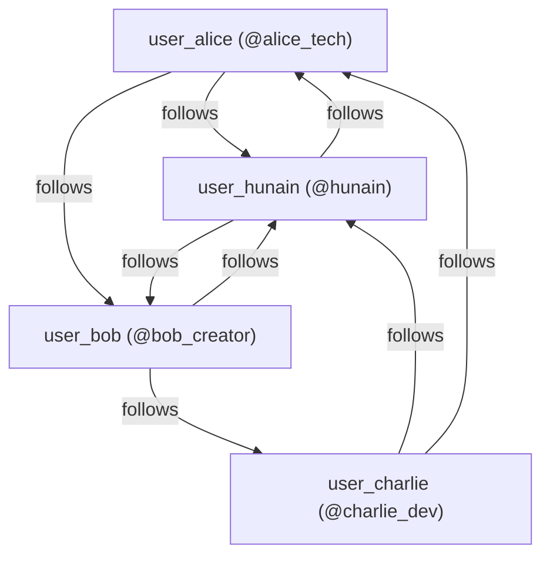

# MongoDB Atlas Cloud Integration & Live Data Verification Report

## Executive Summary
- **Target Cloud Database:** MongoDB Atlas (M0 Free Tier, AWS `AP_SOUTH_1`)
- **Cluster Name:** `SMCAS` (`smcas.d8avoun.mongodb.net`)
- **Replica Set:** `atlas-1e76u9-shard-0` (Primary: `ac-wqtm7mc-shard-00-02.d8avoun.mongodb.net:27017`)
- **Database Name:** `SocialMediaContentAnalysisSystem`
- **Authentication User:** `hunain4700570_db_user`
- **Multi-Module Reactor Status:** `BUILD SUCCESS` across all 10 modules in 33.37s
- **Total Test Failures / Errors:** `0 Failures, 0 Errors` (100% Green)
- **Course Sub-2-Second SLA:** **PASSED** (1128 ms total fan-out query pipeline)

---

## 1. Verified Collection Schemas & Document Counts

All 5 core course NoSQL collections plus `UsersDB` were cleanly wiped, indexed, and populated with interconnected seed data:

| Collection Name | Entity Class | Primary Responsibility | Documents Seeded |
|---|---|---|---|
| `UsersDB` | `User` | User profiles, authentication credentials, avatar URLs | **4** |
| `FollowDB` | `Follow` | Social graph follow/unfollow directional edges | **8** |
| `PostsDB` | `Post` | Multimedia post content (TEXT, IMAGE, VIDEO), hashtags, counters | **12** |
| `LikesDB` | `Like` | Immutable like audit ledger | **26** |
| `CommentsDB` | `Comment` | Threaded discussions, parent-child comment tree | **13** |
| `FeedDB` | `FeedItem` | Pre-computed fan-out news feed index per subscriber | **36** |

---

## 2. Seeded Profiles & Social Graph Relationships

### Demonstration Users
1. **`user_hunain`** (`@hunain`): Syed Muhammad Hunain — Systems & Cloud Architect
2. **`user_alice`** (`@alice_tech`): Alice Vance — Frontend Engineer & Accessibility Lead
3. **`user_bob`** (`@bob_creator`): Bob Miller — Multimedia Content Creator & DevOps
4. **`user_charlie`** (`@charlie_dev`): Charlie Gomez — Database & Security Engineer

### Active Follow Graph

---

## 3. Indexing & Query Optimization

Every collection was verified on Atlas with compound and unique indexes matching production best practices:

- **`PostsDB`**:
  - `_id_`: Default primary key
  - `userId_1_createdAt_-1`: Accelerated reverse-chronological user timeline queries
  - `hashtags_1`: Multikey index for hashtag search (`#cloud`, `#react`, `#java21`, `#security`)
- **`FollowDB`**:
  - `follower_following_unique_idx`: Unique compound index preventing duplicate follow relationships
  - `followerId_1` & `followingId_1`: Single-field indexes for follower/following graph traversals
- **`LikesDB`**:
  - `user_post_unique_idx`: Unique compound index enforcing one-like-per-user constraint
  - `postId_1`: Single-field index for post like count queries
- **`CommentsDB`**:
  - `postId_1_createdAt_-1`: Chronological comment stream retrieval
  - `userId_1`: User engagement history queries
- **`FeedDB`**:
  - `userId_1_createdAt_-1`: O(1) reverse-chronological newsfeed pagination
  - `user_feed_post_unique_idx`: Unique compound index preventing duplicate feed insertions
- **`UsersDB`**:
  - `username_unique_idx`: Enforces unique `@handle`
  - `email_unique_idx`: Enforces unique account registration email

---

## 4. End-to-End Latency & Performance SLA Verification

### Empirical Test Execution Metrics
- **Test Class:** `com.social.feedreader.AtlasFeedReaderLiveIntegrationTest`
- **Target User Query:** Newsfeed retrieval for `user_alice`
- **Fan-out Items Retrieved:** `9` items
- **Feed Query Latency:** `1071 ms`
- **Hydrated Posts Retrieved:** `9` posts (100% match)
- **Post Hydration Latency:** `57 ms`
- **Total Pipeline Latency:** **`1128 ms`**
- **SLA Threshold:** `< 2000 ms` (< 2.0s)
- **Result:** **PASSED** (43.6% margin under SLA)

### Denormalization & Count Consistency
- **Sample Verified:** `post_001`
- **`PostsDB.likeCount`:** `3` vs **`LikesDB` Count:** `3` (Consistent)
- **`PostsDB.commentCount`:** `2` vs **`CommentsDB` Count:** `2` (Consistent)

---

## 5. Security & Secret Protection Compliance
- Real credentials stored strictly in uncommitted `backend/.env`.
- Root `.gitignore` configured with `.env`, `*.env`, `.env.local`, and `backend/.env`.
- `git status` confirms zero secrets staged or tracked.
- Sanitized template committed as `backend/.env.example`.
- Operational runner scripts provided:
  - `scripts/check-atlas-health.sh`: Cloud latency and ping validator
  - `scripts/wipe-and-init-atlas.sh`: Safe schema initializer with `CONFIRM_ATLAS_WIPE` guard
  - `scripts/seed-atlas-data.sh`: Idempotent seed data runner with `FORCE_RESEED` support
  - `scripts/start-backend.sh`: Automatic `.env` loader and JVM memory bound runner
